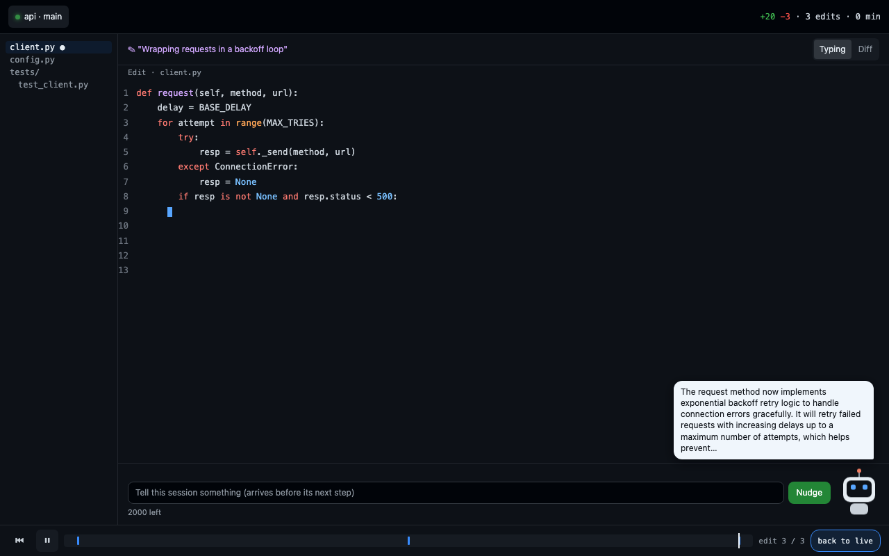

# Mission Control

A localhost page that replays what a Claude Code session is editing, as it happens. It tails the session logs in `~/.claude/projects`, types each edit into a code pane with syntax highlighting, keeps a file tree and a timeline you can scrub, and has a small robot in the corner that explains each edit in a sentence or two using a local Ollama model. There is also a nudge box: type a message and a hook delivers it to the session before its next step (or at the end of its turn).



## Install

Needs Python 3.12+ and [uv](https://docs.astral.sh/uv/).

```
uv sync
uv run mission-control install-hook
```

`install-hook` adds a PostToolUse and a Stop hook to `~/.claude/settings.json`. It shows you the exact diff and asks before writing anything. `uv run mission-control uninstall-hook` removes it. The page works without the hook; you just can't send nudges.

## Run

```
uv run mission-control
```

It prints a URL with a one-time key. Open that link once; after that a cookie keeps you in. The default port is 7788.

| Variable | Default | What it does |
|---|---|---|
| `MC_PORT` | `7788` | Port to listen on (always on 127.0.0.1). |
| `MC_HOME` | `~/.claude/mission-control` | Where the key and the nudge inbox live. |
| `MC_PROJECTS` | `~/.claude/projects` | Where Claude Code session logs are read from. |
| `MC_NARRATOR` | `ollama` | `ollama` or `haiku`. |
| `MC_NARRATOR_MODEL` | `qwen3-coder:30b` (Ollama), `claude-haiku-5-5` (haiku) | Model the robot uses. |
| `MC_OLLAMA_URL` | `http://127.0.0.1:11434` | Ollama endpoint. |
| `ANTHROPIC_API_KEY` | none | Only read when `MC_NARRATOR=haiku`. |

If the model is down or slow, the robot falls back to Claude's own note for that edit.

## Numbers

Measured on an M5 Max, Chromium via Playwright, synthetic Edit events appended to a temp log:

- Hook overhead: 17.6 ms p95 (16.1 ms p50) over 200 runs with an empty inbox. Most of that is Python starting up.
- Log append to the edit showing in the page: 231 ms p95 (105 ms p50) over 20 trials. The watcher polls every 250 ms, so that is most of the gap.
- Robot bubble from edit result to bubble on screen: 639 ms median over 12 edits on `qwen3-coder:30b`. The first one took 6.5 s because the model had to load; the other eleven ranged from 604 to 770 ms.

Method and raw numbers are in the [design spec](docs/superpowers/specs/2026-11-24-mission-control-design.md).

## Security

- The server binds to 127.0.0.1 only.
- Every request needs the random key, passed once in the URL and then held in an HttpOnly, SameSite=Strict cookie.
- POSTs are rejected unless their Origin matches, and nudges are capped at 2,000 characters.
- Secrets are masked before anything leaves the server, and the robot's model only sees masked text and has no tools.

## Vendored

highlight.js 11.12.0, copied into `static/vendor/`. There is no build step.

## Later

- Timelapse export of a session
- Phone access through `tailscale serve`
- A LaunchAgent so it starts at login
